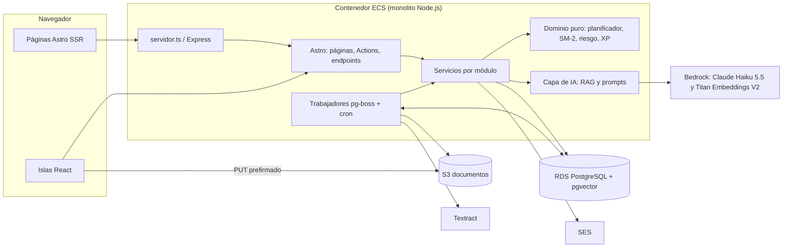
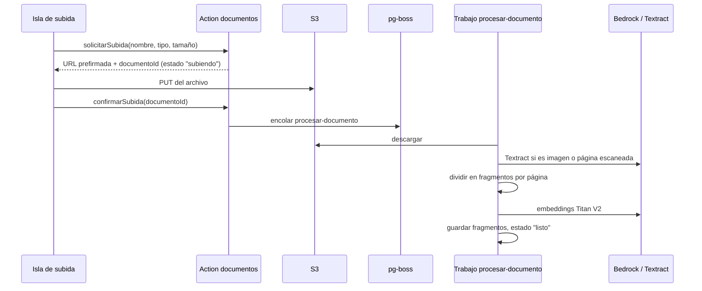

# Arquitectura

## Vista general

Un solo proceso Node.js sirve la web, expone las acciones del backend y ejecuta los trabajos en segundo plano. Todos los datos viven en PostgreSQL, salvo los archivos originales, que viven en S3.

## Capas

Las dependencias van en una sola dirección: **UI → Actions/endpoints → servicios → (dominio, repositorios, IA, adaptadores)**.

| Capa | Ubicación | Responsabilidad | No debe |
|------|-----------|-----------------|---------|
| Páginas | `src/pages/**/*.astro` | Renderizar en el servidor y leer datos llamando a servicios. | Contener SQL o lógica de negocio. |
| Islas | `src/islas/**/*.tsx` | Interacción en el navegador (chat, sesión, calendario, mapa). | Importar nada de `src/servidor/`. Solo llaman Actions o endpoints. |
| Actions | `src/actions/` | Punto de entrada de las mutaciones: valida con Zod, obtiene el usuario de `context.locals`, llama a un servicio. | Contener lógica de negocio. |
| Endpoints | `src/pages/api/` | Solo para lo que las Actions no cubren bien: streaming del chat (SSE), URLs prefirmadas, salud. | Duplicar Actions. |
| Servicios | `src/servidor/modulos/<modulo>/servicio.ts` | Casos de uso. Orquestan repositorios, dominio, IA y trabajos. Verifican permisos. | Conocer detalles de HTTP. |
| Repositorios | `src/servidor/modulos/<modulo>/repositorio.ts` | Consultas Drizzle. Siempre filtran por `usuario_id` cuando corresponde. | Llamar a otros servicios. |
| Dominio | `src/servidor/dominio/` | Funciones puras y deterministas: planificador de rutas, SM-2, cálculo de riesgo, dominio por tema, XP, racha, ligas. | Leer la BD, la hora del sistema o la red. Reciben todo por parámetro. |
| IA | `src/servidor/ia/` | Cliente Bedrock, embeddings, búsqueda híbrida, prompts, validación de salidas. | Guardar en la BD directamente (eso lo hace el servicio). |
| Adaptadores | `src/servidor/adaptadores/` | S3, Textract, SES. | Lógica de negocio. |
| Trabajos | `src/servidor/trabajos/` | Registro de colas y cron de pg-boss. Cada trabajo llama a un servicio. | Lógica propia más allá de leer el payload. |

## Módulos

Cada módulo corresponde a una sección de `contexto/rumbo-funcionalidades.md`.

| Módulo | Sección | Contenido principal |
|--------|---------|---------------------|
| `perfil` | 1 | Perfil ligero, disponibilidad, horarios, privacidad |
| `espacios` | 2 | Espacios de estudio, fecha del examen |
| `documentos` | 2 | Subida, procesamiento, fragmentos |
| `asistente` | 3 | Chat con citas, generación a pedido, reportes de error |
| `temario` | 4 | Temas, subtemas, prerrequisitos, diagnóstico |
| `rutas` | 4 | Ruta, sesiones planificadas, replanificación, modo rescate |
| `sesiones` | 5 | Ejecución de la sesión diaria, pausa, sesión mínima |
| `practica` | 3, 5 | Preguntas, flashcards, respuestas, repetición espaciada, dominio |
| `calendario` | 6 | Consultas para las vistas mensual y semanal, mover sesiones |
| `notificaciones` | 7 | Creación, límites, horario de silencio, envío por correo |
| `riesgo` | 8 | Cálculo diario e intervenciones |
| `dashboard` | 9 | Resumen diario, síntesis semanal, vista general |
| `gamificacion` | 10 | XP, rachas, comodines, insignias, niveles |
| `social` | 11 | Amigos, empujones, compartir y copiar rutas |
| `ranking` | 12 | Ligas y puntajes semanales |
| `demo` | — | Reloj simulado y atajos para la presentación |

Un módulo puede llamar al **servicio** de otro módulo, nunca a su repositorio. Los eventos importantes (sesión completada, respuesta registrada) se publican con un bus de eventos interno en memoria (`src/servidor/eventos.ts`) para que gamificación, ranking y riesgo reaccionen sin acoplarse.

## Flujos principales

### 1. Subida y procesamiento de documentos

La interfaz consulta el estado de los documentos cada 3 segundos mientras haya alguno en `procesando`.

### 2. Temario y ruta

1. Con todos los documentos `listo`, el estudiante pulsa "Analizar curso". Se encola `detectar-temas`.
2. El trabajo genera temas, subtemas, prerrequisitos e importancia (ver `ai-pipeline.md`).
3. El estudiante revisa y ajusta el temario.
4. Diagnóstico opcional: se generan de 5 a 10 preguntas y las respuestas marcan temas como dominados.
5. El servicio `rutas` llama al planificador puro (`dominio/planificador.ts`) y guarda la ruta y sus sesiones planificadas.
6. Se encola `pregenerar-practica` para los temas de los primeros 3 días.

### 3. Chat con citas

La isla del chat envía la pregunta a `POST /api/asistente/mensajes` y recibe la respuesta por Server-Sent Events. El servicio hace búsqueda híbrida, llama a `ConverseStream` y, al terminar, valida las citas y guarda el mensaje (ver `ai-pipeline.md`).

### 4. Ciclo diario (cron)

Todos los cron usan la zona `America/Lima`.

| Hora | Trabajo | Qué hace |
|------|---------|----------|
| 04:00 | `cierre-del-dia` | Marca sesiones vencidas, aplica comodines, actualiza rachas y replanifica rutas atrasadas o adelantadas. |
| 04:30 | `calcular-riesgo` | Calcula el riesgo por usuario y ruta y dispara intervenciones. |
| 05:00 | `generar-resumen-diario` | Genera el resumen de la mañana para cada usuario con actividad ayer. |
| Domingo 05:30 | `generar-sintesis-semanal` | Mapa conceptual, mini simulacro y plan de refuerzo. |
| Lunes 00:05 | `reiniciar-ligas` | Cierra la semana del ranking y arma las ligas nuevas. |
| Cada 15 min | `enviar-notificaciones` | Envía las notificaciones pendientes que respetan la hora preferida, el horario de silencio y el límite diario. |

En `MODO_DEMO`, la ruta `/demo` permite adelantar el reloj de un usuario y ejecutar estos trabajos a pedido.

## Tiempo y reloj

Ningún código de negocio usa `new Date()` ni `Date.now()` directamente. Todo pasa por `src/servidor/reloj.ts`:

- `reloj.ahora(usuarioId)` devuelve la hora actual más el desfase de demo del usuario (`usuario.desfase_demo_dias`, siempre 0 fuera de `MODO_DEMO`).
- `reloj.hoy(usuarioId)` devuelve la fecha local de Lima como `YYYY-MM-DD`.

Las funciones del dominio reciben la fecha por parámetro.

## Arranque

`servidor.ts`:

1. Valida la configuración (`config.ts`).
2. Ejecuta las migraciones pendientes de Drizzle.
3. Arranca pg-boss y registra trabajadores y cron.
4. Monta el handler de Astro en Express y expone `GET /salud`.

Con una sola tarea de ECS no hay problemas de concurrencia en el cron. pg-boss igual garantiza que un trabajo programado se ejecute una sola vez si en el futuro hay más tareas.

## Manejo de errores y observabilidad

- Los servicios lanzan `ErrorDeDominio` con un código (`NO_ENCONTRADO`, `SIN_PERMISO`, `VALIDACION`, `LIMITE_EXCEDIDO`, `CONFLICTO`). Las Actions lo traducen a `ActionError`.
- Los trabajos fallidos se reintentan 3 veces con espera exponencial. Si fallan los 3 intentos, el documento o la entidad queda en estado `error` con un mensaje en español para el usuario.
- Logs en JSON con `nivel`, `modulo`, `usuarioId`, `trabajo` y `duracionMs`. Nunca se registra el contenido de documentos ni los mensajes del chat.
