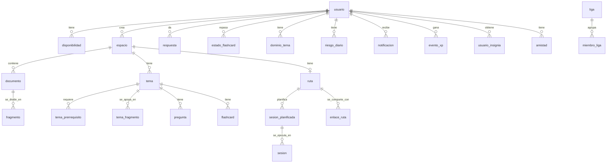

# Modelo de datos

PostgreSQL 17 con `pgvector`. Esquema Drizzle en `src/servidor/db/esquema/<modulo>.ts`. Todas las tablas tienen `id uuid PK default gen_random_uuid()` y `creado_en timestamptz default now()`; no se repiten abajo. `→` indica clave foránea.

Reglas de borrado: las claves hacia `usuario`, `espacio`, `documento`, `ruta` (como dueña) y `tema` usan `ON DELETE CASCADE`. Las referencias entre usuarios distintos (`ruta_origen_id`, `liga.ruta_origen_id`) usan `ON DELETE SET NULL` para que borrar una cuenta no borre las copias de otros.

## Diagrama

## 1. Perfil

### `usuario`
| Columna | Tipo | Notas |
|---------|------|-------|
| `nombre` | text | Visible para amigos |
| `nombre_usuario` | text UNIQUE | 3–20 caracteres `[a-z0-9_]` |
| `avatar` | text | Clave de un avatar predefinido (no se suben fotos en el MVP) |
| `institucion` | text null | Carrera o institución |
| `correo` | text null | Solo para notificaciones |
| `token_hash` | text UNIQUE | SHA-256 del token de la cookie |
| `hora_preferida` | time | Default `19:00` |
| `silencio_inicio` / `silencio_fin` | time | Default `22:00` / `07:00` |
| `limite_notificaciones_dia` | int | Default 3 |
| `mostrar_actividad_a_amigos` | bool | Default true |
| `mostrar_avance_a_amigos` | bool | Default true |
| `permitir_aviso_a_amigos_en_riesgo` | bool | Default false |
| `racha_actual` / `racha_maxima` | int | Default 0 |
| `ultimo_dia_activo` | date null | |
| `comodines_disponibles` | int | 0 o 1. Se recarga cada lunes |
| `consentimiento_en` | timestamptz | Aceptación de la política de datos |
| `desfase_demo_dias` | int | Default 0. Solo con `MODO_DEMO` |
| `actualizado_en` | timestamptz | |

### `disponibilidad`
`usuario_id →`, `dia_semana` int (1 = lunes … 7 = domingo), `minutos` int (0–480). UNIQUE (`usuario_id`, `dia_semana`).

## 2. Espacios y documentos

### `espacio`
`usuario_id →`, `nombre`, `fecha_examen` date, `color` (token de la paleta), `estado` (`configurando` | `analizando` | `activo` | `finalizado`), `ruta_origen_id → ruta` null (si es copia), `actualizado_en`.

### `documento`
| Columna | Tipo | Notas |
|---------|------|-------|
| `espacio_id →` | uuid | |
| `usuario_id →` | uuid | Dueño |
| `nombre` | text | Renombrable |
| `tipo` | enum | `pdf`, `pptx`, `docx`, `imagen` |
| `es_silabo` | bool | |
| `clave_s3` | text | `usuarios/{usuarioId}/espacios/{espacioId}/{documentoId}.{ext}` |
| `tamano_bytes` | int | Máx. 25 MB |
| `total_paginas` | int null | Páginas o diapositivas |
| `estado` | enum | `subiendo`, `procesando`, `listo`, `error` |
| `mensaje_error` | text null | En español |

### `fragmento`
| Columna | Tipo | Notas |
|---------|------|-------|
| `documento_id →` | uuid | ON DELETE CASCADE |
| `espacio_id →` | uuid | Desnormalizado para filtrar la búsqueda |
| `pagina` | int | Página, diapositiva o sección (DOCX) |
| `orden` | int | Posición dentro de la página |
| `texto` | text | |
| `tokens_aprox` | int | |
| `embedding` | vector(1024) | Índice HNSW `vector_cosine_ops` |
| `texto_busqueda` | tsvector GENERATED | `to_tsvector('spanish', texto)`, índice GIN |
| `origen` | enum | `texto`, `ocr` |

## 3. Temario

### `tema`
`espacio_id →`, `tema_padre_id → tema` null, `nombre`, `descripcion`, `orden` int, `importancia` int (1–3), `minutos_estimados` int, `origen` (`automatico` | `manual`), `actualizado_en`.

### `tema_prerrequisito`
`tema_id →`, `requiere_tema_id →`. PK compuesta. Se valida que no haya ciclos antes de guardar.

### `tema_fragmento`
`tema_id →`, `fragmento_id →`, `relevancia` real. Vincula un tema con su evidencia en los documentos.

## 4. Ruta

### `ruta`
| Columna | Tipo | Notas |
|---------|------|-------|
| `espacio_id →` | uuid UNIQUE | Una ruta activa por espacio |
| `usuario_id →` | uuid | |
| `version` | int | +1 en cada replanificación |
| `estado` | enum | `activa`, `completada`, `vencida` |
| `es_modo_rescate` | bool | |
| `temas_fuera_de_plan` | uuid[] | Temas que el modo rescate dejó fuera |
| `ruta_origen_id → ruta` | uuid null | Raíz de las copias (siempre la original, no la copia de una copia) |
| `completada_en` | timestamptz null | |
| `actualizado_en` | timestamptz | |

### `sesion_planificada`
| Columna | Tipo | Notas |
|---------|------|-------|
| `ruta_id →` | uuid | |
| `fecha_programada` | date | |
| `tipo` | enum | `estudio`, `repaso`, `simulacro`, `margen` |
| `temas` | jsonb | `[{ temaId, minutos, parte, totalPartes }]` |
| `minutos_estimados` | int | |
| `estado` | enum | `pendiente`, `en_curso`, `completada`, `vencida`, `reemplazada` |
| `esta_fijada` | bool | Movida a mano |
| `version_ruta` | int | Versión de la ruta que la creó |

Al replanificar, las sesiones futuras no fijadas pasan a `reemplazada` y se crean nuevas. Las pasadas no completadas pasan a `vencida`. Nunca se borran: sirven para el gráfico de avance real vs. planificado.

## 5. Sesión y práctica

### `sesion`
`usuario_id →`, `sesion_planificada_id →` null (null si es mínima suelta), `es_minima` bool, `estado` (`en_curso` | `pausada` | `completada` | `abandonada`), `paso_actual` int, `iniciada_en`, `pausada_en` null, `completada_en` null, `minutos_reales` int, `autoevaluacion` int null (1–5), `datos` jsonb (pasos generados: objetivo, fragmento citado, ids de ítems).

Una sesión `en_curso` o `pausada` sin actividad por más de 24 h pasa a `abandonada` en `cierre-del-dia`.

### `pregunta`
`tema_id →`, `espacio_id →`, `enunciado`, `opciones` jsonb (`string[]`, 4 opciones), `indice_correcto` int, `explicacion`, `citas` jsonb (`[{ fragmentoId }]`, mínimo 1), `origen` (`practica` | `diagnostico` | `simulacro` | `a_pedido`), `esta_oculta` bool (por reporte de error).

### `flashcard`
`tema_id →`, `espacio_id →`, `anverso`, `reverso`, `citas` jsonb, `esta_oculta` bool.

Las preguntas y flashcards pertenecen al **espacio**. Al copiar una ruta se copian a los espacios de quienes la copian.

### `respuesta`
`usuario_id →`, `pregunta_id →`, `sesion_id →` null, `indice_elegido` int, `es_correcta` bool, `respondida_en` timestamptz. Índice (`usuario_id`, `respondida_en`).

### `estado_flashcard`
`usuario_id →`, `flashcard_id →`, `facilidad` real (default 2.5), `intervalo_dias` int, `repeticiones` int, `proxima_revision` date, `ultima_calificacion` int. UNIQUE (`usuario_id`, `flashcard_id`).

### `repaso_flashcard`
Historial: `usuario_id →`, `flashcard_id →`, `sesion_id →` null, `calificacion` int (0–5), `repasada_en`.

### `dominio_tema`
`usuario_id →`, `tema_id →`, `puntaje` real (0–1), `estado` (`dominado` | `en_progreso` | `debil` | `no_visto`), `total_respuestas` int, `es_por_diagnostico` bool, `actualizado_en`. UNIQUE (`usuario_id`, `tema_id`).

## 6. Asistente

### `conversacion`
`usuario_id →`, `espacio_id →`, `titulo`.

### `mensaje`
`conversacion_id →`, `rol` (`usuario` | `asistente`), `contenido` text (markdown), `citas` jsonb (`[{ indice, fragmentoId, documentoId, pagina }]`), `fue_encontrado` bool (false si la respuesta no estaba en los documentos).

### `reporte_error`
`usuario_id →`, `tipo_objeto` (`mensaje` | `pregunta` | `flashcard` | `resumen`), `objeto_id` uuid, `motivo` (`incorrecto` | `no_esta_en_documentos` | `confuso` | `otro`), `comentario` text null.

## 7. Riesgo y notificaciones

### `riesgo_diario`
`usuario_id →`, `ruta_id →`, `fecha` date, `puntaje` int (0–100), `nivel` (`bajo` | `medio` | `alto` | `critico`), `factores` jsonb (aporte de cada factor), `intervencion_aplicada` text null. UNIQUE (`ruta_id`, `fecha`).

### `notificacion`
`usuario_id →`, `tipo` (`recordatorio` | `resumen_diario` | `sintesis_semanal` | `cuenta_regresiva` | `riesgo` | `empujon` | `amistad` | `insignia`), `prioridad` int, `titulo`, `cuerpo`, `enlace`, `canales` text[] (`web`, `correo`), `programada_para` timestamptz, `enviada_en` null, `leida_en` null, `clave_unica` text UNIQUE (evita duplicados, ej. `cuenta_regresiva:{rutaId}:3`).

## 8. Dashboard

### `resumen_diario`
`usuario_id →`, `fecha` date, `contenido` jsonb (`ideasClave[]` con citas, `preguntasFalladas[]`, `flashcardIds[]`, `hoy`, `diasParaExamen` por espacio). UNIQUE (`usuario_id`, `fecha`).

### `sintesis_semanal`
`usuario_id →`, `espacio_id →`, `semana_inicio` date (lunes), `mapa` jsonb (nodos con estado de dominio y aristas de prerrequisito), `mini_simulacro_pregunta_ids` uuid[], `avance` jsonb (serie real vs. planificado), `plan_refuerzo` jsonb (`temaIds[]` con motivo). UNIQUE (`usuario_id`, `espacio_id`, `semana_inicio`).

## 9. Gamificación

### `evento_xp`
`usuario_id →`, `ruta_id →` null, `motivo` (`sesion_completada` | `sesion_minima` | `respuesta_correcta` | `respuesta_incorrecta` | `flashcard_repasada` | `simulacro` | `ruta_completada`), `puntos` int, `referencia_id` uuid null. UNIQUE (`motivo`, `referencia_id`) para no sumar dos veces.

### `uso_comodin`
`usuario_id →`, `fecha_protegida` date.

### `insignia` (catálogo, cargado por semilla)
`clave` UNIQUE (`primer_tema_dominado`, `racha_7`, `primer_simulacro`, `volvi`, `ruta_completada`), `nombre`, `descripcion`, `icono`.

### `usuario_insignia`
`usuario_id →`, `insignia_id →`, `ruta_id →` null, `obtenida_en`. UNIQUE (`usuario_id`, `insignia_id`, `ruta_id`).

El nivel por ruta no se guarda: se calcula del XP (ver `algorithms.md`).

## 10. Social y ranking

### `amistad`
`solicitante_id → usuario`, `receptor_id → usuario`, `estado` (`pendiente` | `aceptada` | `rechazada`), `respondida_en`. UNIQUE del par sin importar el orden.

### `invitacion_amistad`
`usuario_id →`, `codigo` text UNIQUE (10 caracteres), `expira_en`.

### `empujon`
`de_usuario_id →`, `para_usuario_id →`, `mensaje` (de una lista predefinida o texto libre de hasta 140 caracteres). Máximo 3 por día por par.

### `enlace_ruta`
`ruta_id →`, `codigo` text UNIQUE, `incluye_documentos` bool, `esta_activo` bool, `veces_copiada` int.

### `acceso_documento_compartido`
`documento_id →`, `usuario_id →` (quien copió con documentos). Permite citar y abrir documentos ajenos en solo lectura.

### `liga`
`ruta_origen_id → ruta`, `semana_inicio` date, `numero` int.

### `miembro_liga`
`liga_id →`, `usuario_id →`, `ruta_id →`, `es_anonimo` bool, `alias` text null, `esta_oculto` bool, `puntaje_avance` real, `puntaje_constancia` int, `preguntas_respondidas` int, `posicion_final` int null. UNIQUE (`liga_id`, `usuario_id`).
