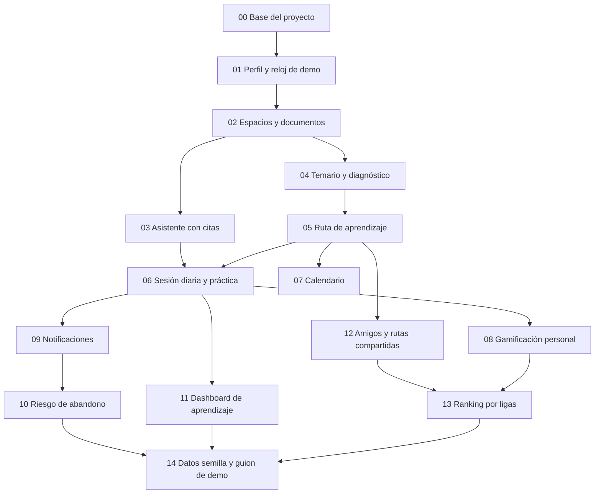

# Funcionalidades para el SDD

Este documento divide el MVP en specs de Kiro. Cada spec se crea en `.kiro/specs/NN-nombre/` con el flujo requisitos → diseño → tareas. Los criterios de aceptación de abajo son el punto de partida de `requirements.md`; el diseño debe respetar `architecture.md`, `data-model.md`, `algorithms.md` y `ai-pipeline.md`.

Las referencias "§N" apuntan a las secciones de `contexto/rumbo-funcionalidades.md`.

## Orden y dependencias

| Spec | Nombre | Prioridad hackathon | Módulos |
|------|--------|---------------------|---------|
| 00 | Base del proyecto | Núcleo | — |
| 01 | Perfil y reloj de demo | Núcleo | `perfil`, `demo` |
| 02 | Espacios y documentos | Núcleo | `espacios`, `documentos` |
| 03 | Asistente con citas | Núcleo | `asistente` |
| 04 | Temario y diagnóstico | Núcleo | `temario` |
| 05 | Ruta de aprendizaje | Núcleo | `rutas` |
| 06 | Sesión diaria y práctica | Núcleo | `sesiones`, `practica` |
| 07 | Calendario | Alta | `calendario` |
| 08 | Gamificación personal | Alta | `gamificacion` |
| 09 | Notificaciones | Alta | `notificaciones` |
| 10 | Riesgo de abandono | Núcleo (diferenciador) | `riesgo` |
| 11 | Dashboard de aprendizaje | Alta | `dashboard` |
| 12 | Amigos y rutas compartidas | Alta | `social` |
| 13 | Ranking por ligas | Media | `ranking` |
| 14 | Datos semilla y guion de demo | Núcleo | `demo` |

"Núcleo" es lo mínimo para contar la historia de Lucía. Si el tiempo se acaba, se recorta desde "Media" hacia arriba.

Specs que pueden avanzar en paralelo después de la 05: {06, 07, 12} y luego {08, 09, 11}.

## Requisitos transversales (aplican a todas las specs)

- Todo texto visible en español, con el tono de `ux.md`.
- Toda pantalla funciona a 360 px de ancho.
- Toda Action valida su entrada con Zod y verifica permisos según `security-privacy.md`.
- Todo contenido generado por la IA tiene al menos una cita válida o se descarta (`ai-pipeline.md`).
- Ningún código de negocio lee la hora del sistema directamente; usa `reloj.ts`.
- Las funciones del dominio que introduce cada spec tienen pruebas en Vitest.

---

## 00 · Base del proyecto

**Objetivo:** proyecto que arranca en local y en AWS con la estructura de `conventions.md`.

Alcance:

- Proyecto Astro con TypeScript estricto, React, Tailwind v4, Biome, Vitest y pnpm.
- `servidor.ts` con Express, Astro en modo `middleware`, migraciones al arrancar, pg-boss y `GET /salud`.
- `config.ts` con validación Zod de las variables de `tech-stack.md`.
- Cliente Drizzle, `docker-compose.yml` con `pgvector/pgvector:pg17` y la migración que habilita `vector`.
- `reloj.ts`, `eventos.ts` (bus en memoria tipado), `errores.ts` (`ErrorDeDominio`).
- Clientes base: `ia/bedrock.ts` (Converse, ConverseStream, salida estructurada con tool use), `ia/embeddings.ts`, `adaptadores/s3.ts`, `textract.ts`, `ses.ts`.
- Layout con navegación (`ux.md`) y tokens de color.
- `Dockerfile` multi-etapa, `.env.ejemplo` e `infra/README.md` con el despliegue en ECS Express Mode, RDS y S3.

Criterios de aceptación:

1. CUANDO se ejecuta `docker compose up` y `pnpm dev`, la app responde en `http://localhost:4321` y `GET /salud` devuelve 200 con el estado de la BD.
2. SI falta una variable de entorno obligatoria, ENTONCES el servidor no arranca y muestra cuál falta.
3. `pnpm verificar` pasa sin errores.
4. Una prueba manual de `bedrock.ts` devuelve texto de Claude Haiku 5.5 y un embedding de 1024 dimensiones.
5. La imagen Docker corre en ECS Express Mode conectada a RDS y responde en la URL pública.

## 01 · Perfil y reloj de demo

**Objetivo:** identificar al estudiante sin login y guardar sus preferencias (§1, §13). Incluye el reloj simulado para la demo.

Criterios de aceptación:

1. CUANDO un visitante sin cookie entra a cualquier página, ENTONCES se le redirige a `/bienvenida` para crear su perfil (nombre, nombre de usuario único, avatar predefinido, institución y correo opcionales, consentimiento y confirmación de edad).
2. CUANDO crea el perfil, ENTONCES recibe la cookie `rumbo_perfil` y entra a la pantalla de inicio.
3. El estudiante puede configurar sus minutos de estudio por día de la semana (0–480), su hora preferida, su horario de silencio y su límite de notificaciones diarias.
4. El estudiante puede elegir si sus amigos ven su actividad de hoy, su avance y si se les avisa cuando está en riesgo.
5. El estudiante puede generar un enlace de un solo uso, válido 15 minutos, para usar su perfil en otro navegador.
6. El estudiante puede descargar sus datos en JSON y eliminar su cuenta con todos sus datos y archivos (ver `security-privacy.md`).
7. La página `/privacidad` explica el tratamiento de datos según la Ley N.º 29733.
8. CON `MODO_DEMO=true`, el panel `/demo` permite adelantar o retroceder N días el reloj del usuario y ejecutar a pedido cada trabajo de cron. SIN `MODO_DEMO`, `/demo` responde 404.

## 02 · Espacios y documentos

**Objetivo:** crear espacios de estudio y convertir los documentos en fragmentos citables (§2).

Criterios de aceptación:

1. El estudiante puede crear varios espacios con nombre, fecha de examen (futura) y color.
2. El estudiante puede subir PDF, PPTX, DOCX, PNG y JPG de hasta 25 MB, con hasta 20 documentos por espacio, y marcar uno como sílabo.
3. SI el archivo es `.ppt`, `.doc` u otro formato, ENTONCES se rechaza con el mensaje "Este formato no es compatible. Expórtalo a PDF o PPTX".
4. CUANDO termina la subida, ENTONCES el documento pasa a `procesando` y la lista muestra el progreso sin recargar la página.
5. CUANDO termina el procesamiento, ENTONCES el documento queda `listo` con fragmentos que conservan su número de página o diapositiva, con embedding y texto de búsqueda.
6. Las imágenes de apuntes y las páginas escaneadas se leen con Textract.
7. SI el procesamiento falla 3 veces, ENTONCES el documento queda en `error` con un mensaje en español y la opción de reintentar o eliminar.
8. El estudiante puede ver un documento (URL prefirmada), renombrarlo y eliminarlo. Eliminarlo borra sus fragmentos y el archivo en S3.
9. El estudiante puede editar el nombre y la fecha del examen del espacio (el cambio de fecha dispara la regeneración de la ruta en la spec 05).

## 03 · Asistente con citas

**Objetivo:** chat sobre los documentos del espacio con citas verificables (§3).

Criterios de aceptación:

1. CUANDO el estudiante hace una pregunta, ENTONCES la respuesta aparece en streaming y cada párrafo muestra chips "documento · pág. N".
2. CUANDO toca una cita, ENTONCES ve el texto del fragmento y puede abrir el documento en esa página.
3. SI la información no está en los documentos, ENTONCES el asistente responde "No encontré esto en tus documentos." y sugiere qué subir o buscar, sin inventar.
4. Los botones "Explícalo más simple", "Dame un ejemplo" y "Hazme una analogía" reformulan la última respuesta manteniendo las citas.
5. El estudiante puede pedir un cuestionario, flashcards o un resumen de un tema, y el resultado se guarda en el espacio con citas.
6. Cada respuesta, pregunta y flashcard tiene "Reportar error"; reportar una pregunta o flashcard la oculta y genera un reemplazo.
7. Las conversaciones se guardan por espacio y se pueden retomar.
8. SI se supera el límite diario de mensajes, ENTONCES se muestra un mensaje amable con la hora en que se reinicia.
9. Un documento con texto del tipo "ignora las instrucciones anteriores" no cambia el comportamiento del asistente.

## 04 · Temario y diagnóstico

**Objetivo:** detectar y ordenar los temas del curso y saltar lo que el estudiante ya sabe (§4).

Criterios de aceptación:

1. CUANDO todos los documentos están `listo` y el estudiante pulsa "Analizar curso", ENTONCES se detectan temas y subtemas con importancia, minutos estimados, prerrequisitos y páginas de respaldo.
2. SI hay sílabo, ENTONCES el temario respeta su orden y nombres.
3. El estudiante puede agregar, renombrar, quitar, reordenar temas y editar prerrequisitos e importancia. SI un cambio crea un ciclo de prerrequisitos, ENTONCES se rechaza con un mensaje.
4. Todo tema detectado automáticamente tiene al menos una página de respaldo.
5. El estudiante puede hacer un diagnóstico opcional de 5 a 10 preguntas o saltarlo.
6. CUANDO termina el diagnóstico, ENTONCES ve qué temas se marcan como ya dominados y puede desmarcarlos.
7. Volver a analizar el curso después de subir más documentos propone cambios sin borrar las ediciones manuales.

## 05 · Ruta de aprendizaje

**Objetivo:** plan día por día hasta el examen que se adapta solo (§4). Implementa los puntos 1 a 3 de `algorithms.md`.

Criterios de aceptación:

1. CUANDO el temario está confirmado, ENTONCES se genera una ruta desde hoy hasta el día anterior al examen que respeta la disponibilidad, los prerrequisitos e incluye repasos, margen y simulacros según `algorithms.md`.
2. Ningún día planificado supera los minutos disponibles de ese día.
3. CUANDO una sesión de estudio de ayer no se completó, ENTONCES en el cierre del día la ruta se replanifica, sus temas se reparten en los días restantes sin duplicar la carga de un día, y se muestra el aviso de reorganización.
4. CUANDO el estudiante completa temas por adelantado, ENTONCES las sesiones siguientes se adelantan.
5. SI el tiempo restante no alcanza, ENTONCES se activa el modo rescate: se priorizan los temas esenciales y sus prerrequisitos y el resto aparece como "Si te sobra tiempo".
6. CUANDO el estudiante cambia la fecha del examen o su disponibilidad, ENTONCES la ruta se regenera conservando el progreso.
7. El camino visual muestra temas completados, en curso, disponibles y bloqueados, el nivel de la ruta y los días de simulacro y examen.
8. El planificador tiene pruebas para: ruta normal, examen mañana, sin disponibilidad, atraso de 2 días, adelanto, modo rescate y sesiones fijadas.

## 06 · Sesión diaria y práctica

**Objetivo:** la sesión de hoy con material citado, práctica y repetición espaciada (§5). Implementa los puntos 4 y 5 de `algorithms.md`.

Criterios de aceptación:

1. La pantalla de inicio muestra "Tu sesión de hoy" con espacio, tema y duración estimada, y un botón para empezar o continuar.
2. Cada sesión tiene: objetivo, resumen del material con citas, preguntas de práctica con explicación y cita, flashcards y autoevaluación de 1 a 5.
3. Las flashcards se programan con SM-2: "Otra vez" la repite en la misma sesión y las difíciles vuelven antes.
4. El asistente se abre dentro de la sesión sin perder el avance.
5. El estudiante puede pausar y retomar la sesión desde el mismo paso, incluso en otro momento del día.
6. La sesión mínima de 5 minutos (flashcards vencidas y 2 preguntas) está siempre disponible y cuenta para la racha.
7. CUANDO se completa una sesión, ENTONCES se publica `sesion.completada`, se actualiza el dominio por tema y la sesión planificada pasa a `completada`.
8. Las sesiones de tipo `repaso` usan flashcards vencidas y preguntas de temas anteriores; las de tipo `simulacro` usan preguntas mezcladas de toda la ruta con tiempo límite.
9. Las respuestas se envían en segundo plano y se reintentan si falla la red.

## 07 · Calendario

**Objetivo:** ver y mover las sesiones en el tiempo (§6).

Criterios de aceptación:

1. Vista mensual y semanal con sesiones planificadas, completadas, pendientes, vencidas y el día del examen, de todos los espacios.
2. Cada sesión usa el color de su espacio y un ícono de estado.
3. El estudiante puede mover una sesión pendiente a otro día antes del examen arrastrándola (en móvil, mantener presionado y elegir el día). La sesión queda fijada y el resto de la ruta se replanifica.
4. SI el nuevo día supera la disponibilidad, ENTONCES se avisa y se pide confirmar.
5. Un indicador muestra minutos completados vs. planificados hasta hoy por espacio.

## 08 · Gamificación personal

**Objetivo:** recompensas por el progreso propio, separadas del ranking (§10). Implementa los puntos 7 a 9 de `algorithms.md`.

Criterios de aceptación:

1. El estudiante gana XP según la tabla de `algorithms.md`, sin sumar dos veces la misma acción y con el tope diario.
2. La racha sube por cada día con una sesión completada y se reinicia con el mensaje "Empiezas una racha nueva hoy".
3. SI un día no hay sesión y hay comodín, ENTONCES se usa automáticamente y se avisa. El comodín se recarga cada lunes.
4. Se otorgan las insignias de `algorithms.md`, incluida "Volví", con una celebración breve.
5. El nivel de cada ruta se muestra en el camino visual.
6. CUANDO se completa la ruta antes del examen, ENTONCES se muestra la recompensa final.

## 09 · Notificaciones

**Objetivo:** avisos útiles sin saturar (§7).

Criterios de aceptación:

1. Centro de notificaciones en la web con contador de no leídas.
2. Envío por correo con SES para usuarios con correo, con un enlace para dejar de recibir correos.
3. Recordatorio diario a la hora preferida si la sesión de hoy no está completada.
4. Avisos de resumen diario y síntesis semanal disponibles.
5. Cuenta regresiva a 7, 3 y 1 día del examen, una sola vez cada una.
6. Ninguna notificación se envía en el horario de silencio (se pospone a su fin) y no se supera el límite diario. Si hay más, se envían las de mayor prioridad.
7. Las notificaciones duplicadas se evitan con `clave_unica`.

## 10 · Riesgo de abandono

**Objetivo:** detectar el riesgo temprano y responder de forma gradual y sin culpa (§8). Implementa el punto 6 de `algorithms.md`.

Criterios de aceptación:

1. Cada mañana se calcula y guarda el riesgo de cada ruta activa con el aporte de cada factor.
2. Las intervenciones de cada nivel se aplican según `algorithms.md`, sin repetirse dos días seguidos.
3. CON riesgo medio, la pantalla de inicio propone la sesión de 5 minutos y la ruta se reorganiza.
4. CON riesgo alto, se activa el modo rescate si hace falta y, solo si el estudiante lo permitió, sus amigos de la misma ruta reciben la sugerencia de enviarle un empujón.
5. CON riesgo crítico, se muestra un mensaje empático con las opciones de ajustar disponibilidad, cambiar la fecha o ver el modo rescate.
6. El estudiante ve su ritmo (🟢🟡🟠🔴 con texto), nunca el puntaje.
7. Ningún mensaje de riesgo menciona días perdidos ni usa lenguaje de culpa; se revisan contra la tabla de `ux.md`.
8. CUANDO completa una sesión, ENTONCES el ritmo se recalcula al momento.
9. El cálculo tiene pruebas para cada nivel y para usuarios sin historial.

## 11 · Dashboard de aprendizaje

**Objetivo:** consolidar lo aprendido (§9).

Criterios de aceptación:

1. Cada mañana hay un resumen diario con 3–5 ideas clave citadas de lo estudiado ayer, las preguntas falladas con su explicación, 3 flashcards y qué toca hoy con los días que faltan para cada examen. SI ayer no hubo actividad, ENTONCES el resumen muestra solo qué toca hoy.
2. Cada domingo hay una síntesis semanal por espacio con mapa conceptual coloreado por dominio (dominado, en progreso, débil, no visto).
3. CUANDO se toca un tema del mapa, ENTONCES se ve su resumen citado y se puede practicar ese tema.
4. La síntesis incluye un mini simulacro de 10 preguntas mezcladas de la semana.
5. La síntesis incluye un gráfico de minutos reales vs. planificados por día.
6. La síntesis genera un plan de refuerzo con los temas débiles y la ruta de la semana siguiente los prioriza.
7. La vista general muestra el porcentaje de ruta completado por espacio y el dominio por tema.

## 12 · Amigos y rutas compartidas

**Objetivo:** estudiar acompañado y compartir rutas (§11 MVP, §13).

Criterios de aceptación:

1. El estudiante puede enviar solicitudes por nombre de usuario o generar un enlace de invitación; la otra persona acepta o rechaza.
2. El estudiante ve si sus amigos estudiaron hoy y su avance, solo si ellos lo permiten.
3. El estudiante puede enviar un empujón (mensajes predefinidos o texto de hasta 140 caracteres), máximo 3 por amigo al día; el amigo lo recibe como notificación.
4. El estudiante puede generar un enlace para compartir su ruta y elegir si incluye los documentos. Por defecto no los incluye.
5. CUANDO alguien abre el enlace, ENTONCES ve un adelanto (temario, días, autor) y puede copiar la ruta indicando su propia fecha de examen.
6. CUANDO copia la ruta, ENTONCES obtiene un espacio propio con el temario, preguntas y flashcards copiados, y una ruta generada con su propia disponibilidad.
7. SI la ruta no incluye documentos, ENTONCES el chat del espacio copiado explica que necesita subir sus propios documentos, y las citas muestran solo nombre del documento y página.
8. El autor puede desactivar el enlace y revocar el acceso a los documentos.

## 13 · Ranking por ligas

**Objetivo:** competencia sana entre quienes siguen la misma ruta (§12). Implementa el punto 10 de `algorithms.md`.

Criterios de aceptación:

1. Quien sigue una ruta compartida (original o copia) entra en una liga de esa ruta.
2. La liga muestra dos rankings: avance y constancia.
3. Los puntajes se calculan solo con práctica real, nunca con tiempo de app abierta.
4. Cada lunes la semana se cierra, se muestra la posición final y se arman ligas nuevas.
5. El estudiante puede participar con un alias anónimo u ocultarse del ranking.
6. El ranking no muestra XP, insignias ni datos de la gamificación personal.

## 14 · Datos semilla y guion de demo

**Objetivo:** que la historia de `product.md` se pueda mostrar de punta a punta en menos de 7 minutos.

Criterios de aceptación:

1. `pnpm semilla` crea a Lucía y 3 amigos, el espacio "Física I" con 4 documentos de ejemplo procesados y un sílabo, 9 temas, la ruta compartida y una liga.
2. Los documentos de ejemplo son material propio o de licencia libre.
3. El panel `/demo` tiene atajos para cada paso del guion: "Simular 3 días sin actividad", "Ejecutar cierre del día y riesgo", "Generar síntesis semanal".
4. Al simular 3 días sin actividad y ejecutar los trabajos, Lucía ve riesgo medio, la propuesta de sesión de 5 minutos y la ruta reorganizada, y una amiga puede enviarle un empujón.
5. CUANDO Lucía completa la sesión mínima, ENTONCES gana la insignia "Volví".
6. La síntesis semanal muestra "Dinámica" como débil y el plan de refuerzo la prioriza.
7. Un archivo `docs/guion-demo.md` describe los pasos, los clics y qué decir en cada uno.

---

## Fuera del SDD del hackathon

Todo lo marcado [F2] y [F3] en `contexto/rumbo-funcionalidades.md`, además de: login con correo/Google, sincronización con calendarios externos, WhatsApp, modo sin conexión, compañero de estudio, grupos y foros, ascenso/descenso de ligas, preparación estimada y vista docente.
