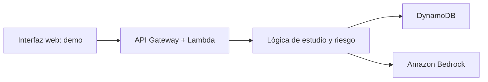

# Rumbo
### Un compañero de estudio para retomar el aprendizaje

**Proyecto colaborativo · Kiro IAThon de AWS · Equipo T034, Los más Kiros**

Rumbo es un prototipo de tecnología educativa que explora cómo transformar materiales de estudio y una fecha objetivo en una experiencia de aprendizaje estructurada. El equipo abordó una dificultad frecuente: organizar el tiempo, priorizar temas y retomar el estudio después de un atraso.

> **Estado:** prototipo de hackathon. La interfaz incluye datos simulados y la API es una pieza independiente. Esta copia no demuestra un recorrido integrado de extremo a extremo ni un despliegue activo.

## Mi participación y equipo

**Angela Soplin Costa** participó en mejoras de la propuesta, gamificación, flujo de experiencia de usuario (UX) y pruebas.

El equipo **Los más Kiros** estuvo integrado por Angela Soplin Costa, Ruth Nadiezhda Araujo Carhuancho, Riggel Rojas, Jorge Quispe Bendezú, Ricardo Quispe Fernandez y Geraldo Emilio Sosa Sosa. El proyecto es resultado de un trabajo colaborativo.

## El problema y la solución propuesta

La propuesta organiza el recorrido del estudiante en cinco momentos: configuración, preparación, planificación, práctica y seguimiento. Su objetivo es facilitar el regreso al estudio mediante intervenciones graduales y sesiones breves.

| Momento | Experiencia planteada | Estado de esta copia |
| --- | --- | --- |
| 1. Comenzar | Entrar y revisar una configuración inicial. | La interfaz usa una sesión de demostración en el navegador. |
| 2. Organizar | Crear un espacio, añadir material y definir una fecha. | Existe una interfaz para material propio; necesita una API configurada y validación adicional. |
| 3. Planificar | Explorar temas y una ruta con sesiones de estudio. | Hay un curso de ejemplo con datos ficticios; el backend contiene lógica de planificación. |
| 4. Practicar | Revisar un tema, responder una pregunta y explorar una flashcard. | Existe una sesión guiada con contenido simulado. |
| 5. Retomar | Identificar atraso y proponer una acción más pequeña. | El panel de demo permite simular riesgo; el backend incluye lógica de seguimiento que requiere validación integrada. |

Las citas, documentos y estadísticas de la demo son ejemplos de interfaz. No representan archivos reales ni prueban que el sistema verifique automáticamente las fuentes.

## Recorrido de la demostración

La demo se ejecuta localmente y no necesita una cuenta AWS para **explorar las pantallas de ejemplo**.

1. Descarga el repositorio y, desde su carpeta raíz, inicia un servidor estático:

   ```bash
   python3 -m http.server 8000 --directory web
   ```

2. Abre `http://localhost:8000/login.html`. Usa el acceso de demostración **usuario `demo` / contraseña `demo01`**. Es una simulación local, no autenticación segura.
3. Completa los pasos de configuración inicial. Al terminar se abre la pantalla de carga; los datos del formulario son parte de la interfaz y no se confirma que personalicen una ruta.
4. En el menú, abre **Hoy** y selecciona **Física I (Demo)** para explorar un espacio de ejemplo con temas y sesiones ficticias.
5. Para observar la ruta y probar una actividad guiada, abre `http://localhost:8000/ruta.html` y luego `http://localhost:8000/sesion.html`. La sesión utiliza contenido fijo.
6. En **Panel de demo**, puedes simular tres días sin estudiar y regresar a **Hoy** para observar el mensaje de reenganche. Esta simulación usa datos locales si no hay un curso conectado.

**Nota:** los enlaces para cargar PDF, generar rutas reales o consultar la API no funcionan con la configuración de ejemplo de esta copia. Algunas pantallas pueden mostrar información fija o tener limitaciones de interacción. La demo depende de JavaScript y de recursos que pueden requerir conexión.

## Arquitectura del prototipo



El diagrama representa los componentes considerados en el proyecto; las flechas no certifican que el flujo esté conectado en esta copia. La interfaz web también puede recorrerse con datos simulados. El proyecto contiene configuración para S3 y CloudFront, además de infraestructura AWS SAM.

## Explorar el código

- [web/](web/): interfaz y recorrido de demostración en HTML, CSS y JavaScript.
- [src/app.py](src/app.py): entrada y rutas de la API.
- [src/ruta.py](src/ruta.py): lógica de planificación.
- [src/ia.py](src/ia.py): integración propuesta con Amazon Bedrock.
- [src/riesgo.py](src/riesgo.py): señales e intervenciones de seguimiento.
- [tests/](tests/): pruebas automatizadas del backend con dependencias simuladas.
- [template.yaml](template.yaml): infraestructura de la API con AWS SAM.
- [.kiro/specs/rumbo/](.kiro/specs/rumbo/): especificaciones del proyecto.

## Pruebas y límites

En una ejecución local con Python 3.12, pytest y boto3 se completaron **91 pruebas** de `src/` y `tests/`. Utilizan dependencias o datos simulados y **no verifican AWS ni el recorrido integrado de usuario**.

```bash
python3 -m venv .venv
source .venv/bin/activate
python -m pip install pytest boto3
AWS_EC2_METADATA_DISABLED=true python -m pytest -q tests
```

Los identificadores de cuenta y enlaces de despliegue de la entrega se reemplazaron por valores de ejemplo. La autenticación de demostración, las referencias simuladas y las rutas de API requieren revisión antes de cualquier uso con información real. Una revisión automatizada de patrones de credenciales no sustituye una auditoría de seguridad.

## Aprendizajes y próximos pasos

- Conectar un único recorrido desde la interfaz hasta la API y verificar la persistencia.
- Revisar accesibilidad, manejo de errores y experiencia en dispositivos móviles.
- Validar las referencias que acompañan a las respuestas de IA.
- Incorporar autenticación y aislamiento de datos antes de trabajar con usuarios reales.
- Mejorar las pruebas de integración y documentar el despliegue reproducible.

El equipo autorizó compartir el código. La distribución detallada de las contribuciones individuales y las condiciones de licencia están pendientes de precisar.
